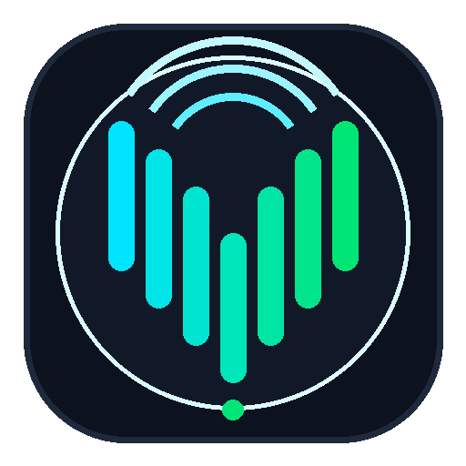

# VBAN Receptor for Android

<p align="center">
  
</p>

<p align="center">
  <strong>Audiophile-Grade, Ultra-Low-Latency VBAN Audio Receptor for Android</strong>
</p>

<p align="center">
  <a href="LICENSE"></a>
  <a href="#"></a>
  <a href="#"></a>
  <a href="#"></a>
  <a href="#"></a>
  <a href="#"></a>
  <a href="#"></a>
</p>

---

## Overview

**VBAN Receptor for Android** is an open-source, high-fidelity wireless audio receiver implementing the **VBAN (VB-Audio Network)** protocol. Designed specifically for audiophiles, audio engineers, and low-latency audio applications, it turns any modern Android smartphone, tablet, or digital audio player (DAP) into a high-performance network audio endpoint.

Built with **C++20 (Android NDK)**, **Google Oboe**, and **Jetpack Compose**, the app delivers sub-millisecond internal buffer processing, adaptive clock drift compensation, and direct **bit-perfect USB DAC bypass** on Android 14+.

---

## Key Features

- **High-Resolution Audiophile Playback**:
  - Full support for all 21 official VBAN sample rates ($6\text{ kHz}$ to $705.6\text{ kHz}$) plus the $768\text{ kHz}$ audiophile extension.
  - Formats: 16-bit signed PCM, 24-bit packed signed PCM, 32-bit integer PCM, and 32-bit IEEE 754 Floating Point.
- **Ultra-Low Latency Real-Time Audio Core**:
  - Powered by **Google Oboe 1.9.0** running over the **AAudio** native backend in exclusive mode (`PerformanceMode::LowLatency`).
  - Capable of buffer sizes as low as a single audio burst on supported hardware.
- **Lock-Free Single-Producer Single-Consumer (SPSC) Ring Buffer**:
  - Fixed capacity of $2^{18}$ frames ($262,144$ frames, $\approx 341.3\text{ ms}$ at $768\text{ kHz}$ stereo).
  - Cache-line aligned (`alignas(64)`) read and write atomic counters to eliminate core false sharing.
  - Zero heap allocations, mutexes, or system calls inside the real-time audio thread.
- **Adaptive Clock Drift Compensation**:
  - Real-time proportional-integral (PI) drift servo with 2nd-order slow EMA jitter filtering.
  - 4-point **Catmull-Rom cubic Hermite spline** micro-resampling smoothly aligns transmitter and DAC quartz crystal clocks ($\pm 100\text{ PPM}$) without audible clicks, pitch jitter, or phase distortion.
- **Android 14+ Bit-Perfect USB DAC Bypass**:
  - Direct integration with `AudioManager.setPreferredMixerAttributes` and `MIXER_BEHAVIOR_BIT_PERFECT`.
  - Completely bypasses Android's global audio mixer and SRC (Sample Rate Converter), delivering bit-exact digital audio directly to external USB DACs.
- **Zero-Config Network Discovery**:
  - Automatically listens for and detects active VBAN streams on the local network (UDP port 6980).
  - Displays detected transmitters with one-tap connection from the UI.
- **Real-Time Reactive Jetpack Compose UI**:
  - Dual 60 FPS Stereo VU meters with peak-hold decay ($-60\text{ dBFS}$ to $0\text{ dBFS}$).
  - 64-band logarithmic FFT Spectrum Analyzer ($8\text{ Hz}$ sub-bass to $22\text{ kHz}$ treble) with sub-bass interpolation.
  - Live buffer occupancy gauge, RFC 3550 inter-arrival network jitter meter, and packet loss counters.
- **Rock-Solid Background Playback**:
  - Android 14 compliant Foreground Service (`type="mediaPlayback"`).
  - Triple power-network lock manager: `WifiLock` (`WIFI_MODE_FULL_LOW_LATENCY`), `WakeLock`, and `MulticastLock` prevent audio dropouts when the screen is locked or turned off.

---

## Architecture

```
                          UDP Network (Port 6980)
                                     │
                                     ▼
┌────────────────────────────────────────────────────────────────────────┐
│ Native Network Thread (vban_receiver)                                  │
│ - 4 MB SO_RCVBUF UDP Socket (Unicast & Multicast IP_ADD_MEMBERSHIP)    │
│ - 10-Step Header & Payload Packet Validation Pipeline                  │
│ - Monotonic nuFrame Tracking & RFC 3550 Jitter Estimation              │
│ - SIMD NEON / SSE Zero-Allocation Dequantization to Float32 [-1.0f, +1]│
└───────────────────────────────────┬────────────────────────────────────┘
                                     │ Interleaved Float32 Audio Frames
                                     ▼
┌────────────────────────────────────────────────────────────────────────┐
│ Lock-Free SPSC Circular Buffer (spsc_ring_buffer)                      │
│ - Capacity: 2^18 frames (262,144 frames = 341.3 ms at 768 kHz)         │
│ - Cache-line aligned (alignas(64)) read & write atomic indices         │
│ - Monotonic uint64_t counters with acquire/release memory semantics    │
│ - ZERO dynamic allocations or system calls during streaming            │
└───────────────────────────────────┬────────────────────────────────────┘
                                     │ High-Priority Audio Callback Thread
                                     ▼
┌────────────────────────────────────────────────────────────────────────┐
│ Oboe Audio Engine & Clock Drift Compensator (oboe_player)              │
│ - Adaptive Clock Drift Servo: EMA Jitter Filter + PI Drift Controller  │
│ - Micro-Interpolation: Catmull-Rom Cubic Hermite Spline Resampling     │
│ - 64-Band FFT Spectrum Analyzer with Sub-Bass Interpolation (8Hz-22kHz)│
│ - Oboe 1.9.0 AAudio Exclusive Mode (Up to 768 kHz, LowLatency)         │
│ - Decoupled Stream Reconfiguration with 128-sample Cosine Crossfade    │
└───────────────────────────────────┬────────────────────────────────────┘
                                     │
                                     ▼
                  Hardware Audio HAL / External USB DAC
```

For comprehensive engineering details, mathematical equations, and thread synchronization models, see [docs/ARCHITECTURE.md](docs/ARCHITECTURE.md).

---

## Hardware & System Requirements

| Specification | Minimum | Recommended |
|:--------------|:--------|:------------|
| **Android Version** | Android 8.0 (Oreo, API 26) | Android 14+ (Upside Down Cake, API 34) |
| **CPU Architecture** | 64-bit ARM (`arm64-v8a`) or `x86_64` | ARM64 with NEON SIMD support |
| **Network** | 2.4 GHz 802.11n Wi-Fi | 5 GHz Wi-Fi (802.11ac/ax) or USB-C Gigabit Ethernet |
| **Audio Output** | Built-in speaker / 3.5mm jack | High-Resolution External USB DAC / Headphone Amp |

---

## Quick Start: Streaming from PC (Voicemeeter)

1. **Connect both devices to the same local network** (5 GHz Wi-Fi or wired Ethernet recommended for lowest jitter).
2. **Find your Android device's IP address** (displayed at the top of the VBAN Receptor app, e.g. `192.168.1.150`).
3. **Open Voicemeeter (Banana / Potato) on PC**:
   - Click the **VBAN** button in the top-right corner to open the VBAN Configuration dialog.
   - In the **VBAN Outgoing Streams** section:
     - Check **On** to enable the stream.
     - **Stream Name**: e.g., `Stream1` (or any custom name).
     - **IP Address to**: Enter your Android device's IP (e.g. `192.168.1.150`).
     - **Port**: `6980` (default VBAN port).
     - **Sample Rate**: Select your desired rate (e.g., `48000`, `96000`, or `192000`).
     - **Bit**: `16` or `24` bits.
     - **Source**: Select your audio bus (`BUS A1`, `BUS B1`, etc.).
4. **On your Android device**:
   - Open **VBAN Receptor**.
   - Tap **Discover Streams** to automatically detect the incoming stream, or enter the **Stream Name** (`Stream1`) and **Port** (`6980`) manually.
   - Select your output device (Built-in, Headphones, or USB DAC).
   - Tap **Start Receptor**. Audio will begin playing immediately.

---

## Building from Source

### Prerequisites
- **JDK 17** (e.g. Eclipse Adoptium or OpenJDK 17)
- **Android Studio** (Iguana / Jellyfish or newer)
- **Android SDK Platform 34**
- **Android NDK**: version `26.1.10909125`
- **CMake**: version `3.22.1` or higher
- **Python 3.10+** (for running the end-to-end verification suite)

### Clone the Repository
```bash
git clone https://github.com/gek0v/vban-receptor.git
cd vban-receptor
```

### Build the Android App (Debug APK)
```bash
# Windows
.\gradlew.bat assembleDebug

# Linux / macOS
./gradlew assembleDebug
```
The compiled APK will be generated at:
`app/build/outputs/apk/debug/app-debug.apk`

### Run Unit & Instrumented Tests
```bash
# Run Android JVM unit tests
.\gradlew.bat testDebugUnitTest

# Run native C++ standalone tests (CMake / CTest)
cmake -B build_native_test -S native_tests
cmake --build build_native_test --config Release
ctest --test-dir build_native_test -C Release --output-on-failure
```

---

## Contributing

Contributions, bug reports, and pull requests are warmly welcomed! Please read [CONTRIBUTING.md](CONTRIBUTING.md) for code style guidelines, workflow practices, and testing requirements before submitting a PR.

---

## Security

If you discover a security vulnerability within VBAN Receptor, please review our [Security Policy](SECURITY.md) for responsible disclosure instructions.

---

## Legal & Trademark Notice

**VBAN (VB-Audio Network)** is a proprietary audio network protocol developed by **Vincent Burel / VB-Audio Software** (https://vb-audio.com).

This open-source project is an independent clean-room implementation developed in accordance with the publicly published VBAN protocol specifications for personal, educational, and developer use. This project is not affiliated with, sponsored by, or officially endorsed by VB-Audio Software.

---

## License

This project is licensed under the **MIT License** — see the [LICENSE](LICENSE) file for details.

Copyright (c) 2024-2026 **gek0v**.
